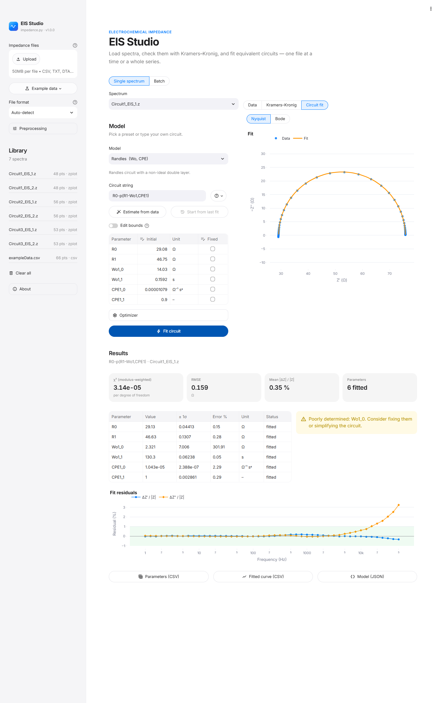
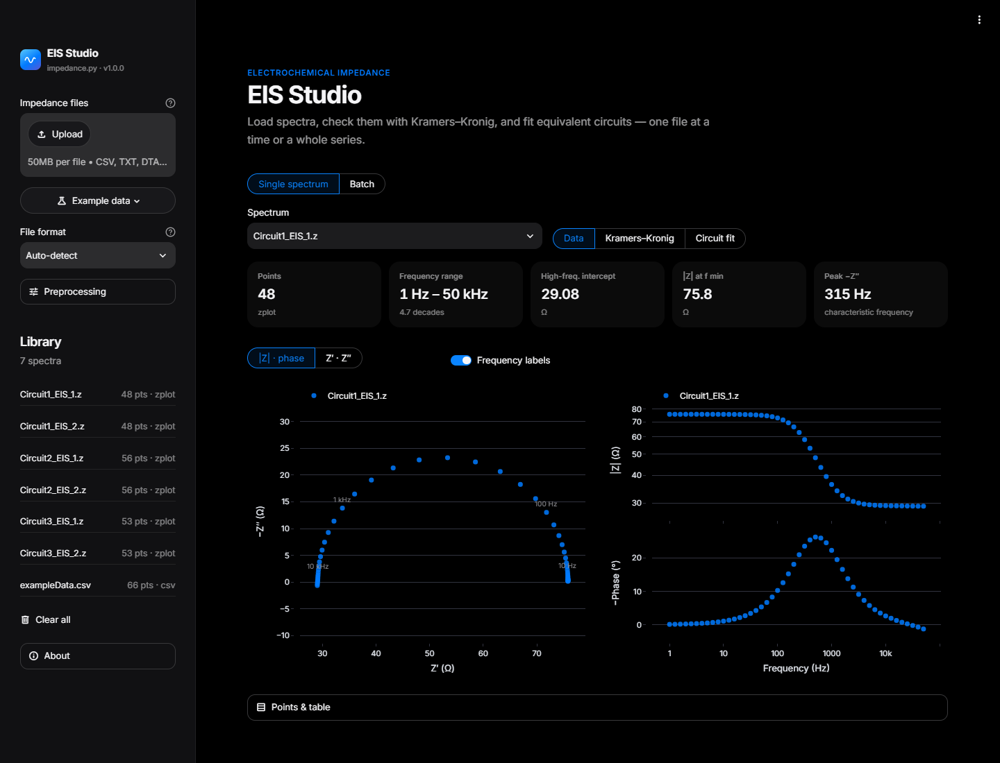

# EIS Studio

A browser app for **electrochemical impedance spectroscopy (EIS)**, built with
[Streamlit](https://streamlit.io) on top of
[impedance.py](https://github.com/ECSHackWeek/impedance.py). You can load spectra
from common potentiostats, check them with a Kramers–Kronig test, fit equivalent
circuits, and process a whole series of files in one batch. You do not need to
write any code.



## Features

| Area | What you can do |
|---|---|
| **Load** | Auto-detects Gamry `.DTA`, BioLogic `.mpt`, ZPlot `.z`, VersaStudio `.par`, Autolab / Parstat / PowerSuite / CH Instruments `.txt`, and plain CSV. A **generic table** importer lets you pick the frequency, Z′/Z″ or \|Z\|/phase columns, and flip a sign. Example datasets are built in. |
| **Preprocess** | Frequency window, removal of inductive points (Z″ > 0), sign flip, normalisation by electrode area (Ω·cm²), and removal of single points. |
| **Visualise** | Interactive Nyquist plot (equal aspect, frequency-decade labels), Bode plot (\|Z\| and phase, or Z′ and Z″), and residual plots. Plots export as SVG. |
| **Validate** | Lin-KK test (Schönleber 2014) in three modes: *Auto* (robust μ scan, see below), *Schönleber* (library default), and *Manual M*. Complex, real, or imaginary fit, with an optional series capacitance. |
| **Fit** | 10 presets (Randles, R‖Q, two-arc, Li-ion cell, coated metal, Gerischer, transmission line…) or any custom circuit string. Initial guesses are estimated from the data, and a **live preview** shows the curve for those guesses before you fit. You can fix parameters, edit bounds, choose \|Z\| weighting or none, and use global basin-hopping search. |
| **DRT** | Distribution of relaxation times from [bayes_drt2](https://github.com/jdhuang-csm/bayes-drt2) (Huang et al. 2020), with three solvers. **Ridge** (hyperparametric, fast, no compiler needed) uses the *Huang* or *Ciucci* preset. **Bayesian MAP** gives a calibrated hierarchical estimate. **Bayesian HMC** adds a 95 % credible interval. Options include an outlier-robust error model and a non-negative constraint. Outputs: R∞, Rp and inductance, and the DRT decomposed into Havriliak–Negami peaks (R, τ₀, f, α, β, share of Rp). In batch mode you get an overlay of every DRT plus trends for Rp, R∞ and the peaks. |
| **Results** | Parameters with ±1σ and % error, χ² per degree of freedom, RMSE, mean relative error, effective capacitance (Brug formula) and peak frequency for each R‖C / R‖CPE pair, and a warning for parameters that the data does not determine well. |
| **Batch** | One circuit fitted across many files. Starting values can come from the table, from the previous fit (*chain*), or from a new estimate for each file. Optional Lin-KK for each spectrum, parameter-trend plots (by index or by the number in the file name), and an overlay of all fits. |
| **Export** | Parameters CSV, fitted-curve CSV, model JSON (opens with `impedance.py` `CustomCircuit().load()`), batch summary CSV, and a ZIP with everything. |

### Design

The UI follows Apple's Human Interface Guidelines:

* **Clarity:** the system font (SF Pro on Apple devices, Inter or Segoe UI on other systems), a strong type hierarchy, plain-language labels, and one primary action per view.
* **Deference:** the spectra fill the canvas. The window chrome stays quiet, the header is translucent and blurred, and colour marks only data and state.
* **Depth:** layered tiles, gentle motion that respects *reduce motion*, and segmented controls for switching views.
* Full **light and dark appearance** in Apple system colours. The app follows your OS setting, and you can override it in ⋮ → Settings.



## Run it on your own computer (no programming needed)

1. Download this folder (on GitHub: **Code → Download ZIP**) and unzip it.
2. Start the app:

| System | What to do |
|---|---|
| **Windows** | Double-click **`Start EIS Studio.bat`**. If Python is missing, it offers to install Python 3.12 for you, using Microsoft winget. |
| **macOS** | Double-click **`Start EIS Studio.command`**. If macOS blocks it, right-click the file and choose **Open**. Python 3.10–3.13 is required; get it from [python.org](https://www.python.org/downloads/). |
| **Linux** | Run `bash start_eis_studio.sh` in a terminal. Install Python first if needed, e.g. `sudo apt install python3 python3-venv`. |

The first start downloads the app's components, which takes about 2–5 minutes
and needs internet. After that the app opens in a few seconds and works
offline. Your browser opens the app automatically. To stop it, close the
terminal window.

Everything is installed into a private folder, so your system Python and
cloud-synced folders are left untouched:

* Windows: `%LOCALAPPDATA%\EISStudio`
* macOS: `~/Library/Application Support/EISStudio`
* Linux: `~/.local/share/eis-studio`

Delete that folder to uninstall.

**Options** (add them after the launcher, e.g. `"Start EIS Studio.bat" --bayes`):

| Option | Effect |
|---|---|
| `--bayes` | One-time install of CmdStan for the Bayesian MAP/HMC DRT. Takes 5–15 minutes and needs a C++ compiler. On Windows it installs one automatically; on macOS run `xcode-select --install` first. |
| `--check` | Set up and verify the installation without starting the app. |
| `--reset` | Re-create the private environment, e.g. after a failed install. |
| `--port 8600` | Use a specific port. |

### For developers
```bash
pip install -r requirements-dev.txt
streamlit run app.py
```

## Deploy

### Streamlit Community Cloud (free, simplest)
1. Push this folder to a GitHub repository.
2. Go to [share.streamlit.io](https://share.streamlit.io), click **Create app**, and choose the repo, the branch, and `app.py`.
3. Under *Advanced settings*, choose Python 3.12, then click **Deploy**.

The service installs from `requirements.txt` and reads the theme from `.streamlit/config.toml`.

### Docker (Render, Railway, Fly.io, Google Cloud Run, Azure, your own server)
```bash
docker build -t eis-studio .                          # ridge DRT
docker build -t eis-studio --build-arg WITH_STAN=1 .  # + Bayesian MAP / HMC DRT
docker run -p 8501:8501 eis-studio
```
`WITH_STAN=1` installs CmdStan and compiles the bayes_drt2 models into the image
at build time. The image grows by about 1 GB and the build takes about 10 minutes,
but users never have to wait for a compile.

### Bayesian DRT (MAP / HMC) when running locally
Ridge DRT works straight after `pip install -r requirements.txt`. The Bayesian
solvers also need CmdStan, which is a one-time install:
```bash
python -c "import cmdstanpy; cmdstanpy.install_cmdstan()"                # macOS / Linux
python -c "import cmdstanpy; cmdstanpy.install_cmdstan(compiler=True)"   # Windows
```
The first MAP or HMC run compiles the Stan model, which takes about 1 minute;
later runs reuse it. On Streamlit Community Cloud only ridge DRT is available,
and the app labels the Bayesian options as unavailable.
The image runs as a non-root user, has a health check on `/_stcore/health`, and
honours the `$PORT` variable that most PaaS hosts set.

### Hugging Face Spaces
Create a **Docker** Space and push this folder. The Dockerfile works as it is.
Set `app_port: 8501` in the Space's README front-matter.

## Test

```bash
pip install -r requirements-dev.txt
pytest
```
The suite has 36 tests, including DRT tests: ridge recovers two known processes (R and f within 5–10 %), and batch DRT runs through the UI.
* **Engine tests:** every instrument format loads, the generic importer works, circuit validation rejects bad input, all presets give sensible initial guesses, a fit recovers known synthetic parameters, fixed parameters work, the global optimiser runs, and Lin-KK passes on clean data.
* **End-to-end UI tests:** they use Streamlit's headless `AppTest` to go from the empty state through loading, Kramers–Kronig, fitting, and batch processing.

## Project layout

```
Start EIS Studio.bat    Windows double-click launcher
Start EIS Studio.command, start_eis_studio.sh   macOS / Linux launchers
launcher.py             cross-platform setup + start (private environment)
app.py                  Streamlit UI (sidebar library, single and batch views)
eis_studio/
  io.py                 file loading: impedance.py readers, auto-detect, generic table
  analysis.py           preprocessing, Lin-KK, circuit parsing/guessing/fitting, derived values
  drt.py                DRT via bayes_drt2 (ridge / MAP / HMC), HN peak decomposition
  citations.py          software + literature references (in-app panels, CITATION.txt)
  plots.py              Plotly figures (Nyquist, Bode, residuals, KK scan, DRT, trends)
  ui.py                 Apple-style CSS and components
CITATION.cff            machine-readable citation metadata
.streamlit/config.toml  theme (light + dark), upload limit
sample_data/            example spectra from impedance.py
tests/                  pytest suite (engine + headless UI)
Dockerfile, requirements*.txt, pyproject.toml
```

## Notes on the analysis

* **Sign convention:** Z = Z′ + jZ″, with Z″ < 0 for capacitive behaviour. Plots show −Z″. If your semicircles appear below the axis, turn on *File stores −Z″*.
* **χ²:** Σ[(ΔZ′)² + (ΔZ″)²] / |Z|², divided by (2N − p), where N is the number of data points and p the number of fitted parameters (Boukamp's definition).
* **Effective capacitance for R‖CPE:** C_eff = (R·Q)^(1/α) / R (Brug et al. 1984). The peak frequency is f = 1 / [2π (R·Q)^(1/α)].
* **Lin-KK "Auto" mode:** at low M, the under-fit gives negative R_k, which makes μ < c. The library loop can therefore stop too early: on clean synthetic data it stopped at M = 3 with 75 % residuals. Auto mode looks only at values of M where χ² is within 100× of its minimum, then takes the first M where μ < c for two M values in a row. The μ/χ² scan is plotted so you can check the choice.
* **bayes_drt2 adaptations** (pinned commit `99d5b60`):
  * `Inverter.fit_peaks` passes its arguments to `predict_distribution` in the wrong order, so EIS Studio calls `bayes_drt2.peak_fit.fit_peaks` directly.
  * Stan normally compiles models inside site-packages, which is read-only on most hosts. EIS Studio copies the model files to a writable cache (`$EIS_STUDIO_STAN_CACHE`) and compiles them there.
* **NumPy 2 compatibility:** impedance 1.7.1 on PyPI fails in Lin-KK under NumPy 2. EIS Studio includes the fixed `eval_linKK` from impedance.py `main`.

## How to cite

EIS Studio is a graphical front end. **The numerical work is done by the
open-source packages below. Please cite them**, and the methods you used, in
any publication.

The app helps you do this in three places:
* every result view has a **How to cite** panel;
* every exported ZIP contains a `CITATION.txt` that lists the references for the analyses it holds;
* `CITATION.cff` gives the same references in machine-readable form.

### Source code used

| Package | Used for | Source code | Version | Licence |
|---|---|---|---|---|
| **impedance.py** | file readers, circuit models and fitting, Lin-KK | <https://github.com/ECSHackWeek/impedance.py> | 1.7.1 (PyPI) | MIT |
| **bayes_drt2** | DRT: ridge, Bayesian MAP and HMC; HN peak fits | <https://github.com/jdhuang-csm/bayes-drt2> | 0.2, commit [`99d5b60`](https://github.com/jdhuang-csm/bayes-drt2/tree/99d5b603d98469a6382ddde5210a1bfdc0d76b3d) | BSD 3-Clause |
| CmdStan / cmdstanpy | Stan engine for Bayesian DRT | <https://github.com/stan-dev/cmdstanpy> | ≥ 1.2 | BSD 3-Clause |

### References
1. M. D. Murbach, B. Gerwe, N. Dawson-Elli, L. Tsui, *impedance.py: A Python package for electrochemical impedance analysis*, J. Open Source Softw. **5** (52), 2349 (2020). <https://doi.org/10.21105/joss.02349>
2. J. Huang, M. Papac, R. O'Hayre, *Towards robust autonomous impedance spectroscopy analysis: a calibrated hierarchical Bayesian approach for EIS inversion*, Electrochim. Acta **367**, 137493 (2021). <https://doi.org/10.1016/j.electacta.2020.137493>. Cite this for any DRT result.
3. F. Ciucci, C. Chen, Electrochim. Acta **167**, 439–454 (2015). <https://doi.org/10.1016/j.electacta.2015.03.123>. Cite this for ridge DRT (hyperparametric λ).
4. M. B. Effat, F. Ciucci, Electrochim. Acta **247**, 1117–1129 (2017). <https://doi.org/10.1016/j.electacta.2017.07.050>
5. B. Carpenter et al., *Stan: A probabilistic programming language*, J. Stat. Softw. **76** (2017). <https://doi.org/10.18637/jss.v076.i01>. Cite this for Bayesian MAP/HMC DRT.
6. M. Schönleber, D. Klotz, E. Ivers-Tiffée, Electrochim. Acta **131**, 20–27 (2014). <https://doi.org/10.1016/j.electacta.2014.01.034>. Cite this for Lin-KK.
7. G. J. Brug et al., J. Electroanal. Chem. **176**, 275–295 (1984). <https://doi.org/10.1016/S0022-0728(84)80324-1>. Cite this for effective capacitance.

MIT licence. See `LICENSE` for the impedance.py notice.
